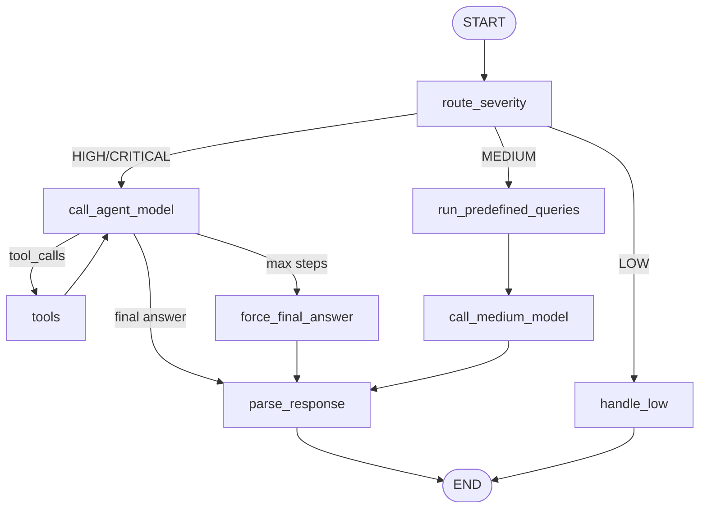

# Exploration: Data Quality Agent (LangGraph)

## 1. Introduction

### What Is This?

The **Data Quality (DQ) Agent** is an AI-powered tool that automatically investigates data quality failures in our Databricks data platform. Instead of a data engineer manually writing SQL queries to trace why a DQ check failed, the agent does the investigation autonomously — querying tables, checking history, and producing a structured root-cause analysis.

It is built using **LangGraph** (a framework for building stateful AI agent workflows) and runs on **Databricks** using Foundation Model APIs.

### Why Do We Need It?

Our ETL pipeline loads data daily through three layers:

- **Landed** (bronze) — raw data from source systems
- **Primary/Curated** (silver) — cleaned, joined, business-ready tables
- **Derivative** (gold) — enriched tables for downstream consumers

After each curated load, DQ checks run automatically (duplicate detection, null rate checks, referential integrity, etc.). When checks fail, a data engineer currently has to:

1. Look at the failure details
2. Manually query the source (landed) tables to find the root cause
3. Determine if the issue is in the source data or our ETL logic
4. Decide what action to take

The DQ Agent automates steps 1 through 4. It receives the DQ check results, investigates using SQL queries against Unity Catalog, and produces an analysis with root causes and recommendations — all within seconds.

### Where Does It Live?

- **Repository**: `gr.cepal.dna.de.lng-lnd-cup` (branch: `DT-819_dq_exploration`)
- **Path**: `src/helpers/curated_helpers/dq_agent_langgraph/`
- **Jira Ticket**: DT-819

---

## 2. Architecture Overview

### High-Level Flow

The agent receives DQ findings and produces a structured analysis:

1. DQ Check Results (findings) come in
2. The DQ Agent (LangGraph) processes them: routes by severity, investigates using tools, produces analysis
3. Outputs include: root cause summary, landed table origin, recommendations, and an MS Teams alert

### What Is an "Agent"?

An AI agent is a program that uses a Large Language Model (LLM) to make decisions. Unlike a simple chatbot that just answers questions, an agent can:

- **Use tools** — execute SQL queries, check table schemas, look up history
- **Reason in loops** — examine a result, decide what to query next, repeat until it has enough evidence
- **Produce structured output** — not just free text, but JSON with specific fields (root causes, recommendations, etc.)

Think of it like giving a junior data engineer a set of SQL tools and instructions: "Here is a DQ failure. Investigate it. Tell me what went wrong and what to do." The agent follows a similar process, but automatically.

### File Structure

| File | Purpose | Analogy |
|------|---------|---------|
| `state.py` | Defines what the agent knows (shared data structure) | A form that gets filled in as investigation progresses |
| `tools.py` | Defines what the agent can do (SQL, schema lookup, DQ history) | The toolkit — like having access to a SQL client |
| `prompts.py` | Defines what the agent is told (instructions for the LLM) | The runbook — tells the agent how to investigate |
| `graph.py` | Defines how the agent thinks (decision flow) | The process flowchart — which steps to take and when |
| `graph_builder.py` | Factory that creates the agent | The setup script — wires everything together |
| `evals.py` | Tests the agent with mock data | Unit tests — synthetic scenarios with expected results |
| `teams_alerting.py` | Sends results to MS Teams | Notification layer — Adaptive Cards via webhook |
| `app/agent.py` | Deploys as a Databricks App | REST API + Chat UI wrapper |

---

## 3. Core Concepts (for Data Engineers)

### 3.1 LangGraph — What Is It?

[LangGraph](https://langchain-ai.github.io/langgraph/) is a Python library for building AI agents as **graphs** (nodes connected by edges). It is built on top of [LangChain](https://www.langchain.com/).

Key concepts:

- **Node**: A Python function that does one thing (e.g., "call the LLM", "execute tool calls", "parse the response")
- **Edge**: A connection between nodes (e.g., "after routing, go to the agentic path")
- **Conditional Edge**: A connection that depends on a condition (e.g., "if severity is HIGH, go to agentic path; if MEDIUM, go to predefined queries")
- **State**: A shared dictionary that all nodes read from and write to — this is how data flows through the graph
- **Compiled Graph**: The final runnable object that you invoke with input data

**Why LangGraph instead of just calling an LLM directly?**

A plain LLM call is stateless — you send a prompt, get a response. But investigation requires multiple steps: query, analyze result, query again, conclude. LangGraph manages this loop, keeping track of all messages and tool results, and knowing when to stop.

### 3.2 State — The Shared Memory

All nodes in the graph share a single `AgentState` dictionary. Think of it as a form that gets progressively filled in.

**Input fields** (set when you start the agent):

| Field | Type | Example |
|-------|------|---------|
| `findings` | list of DQ check results | `[{"check_name": "duplicate_detection", "table_name": "...exposure", "severity": "HIGH", ...}]` |
| `run_date` | string | `"2026-07-12"` |
| `catalog` | string | `` `p-cdh` `` |
| `env_prefix` | string | `"p"` |

**Routing field** (set by the router node):

| Field | Type | Values |
|-------|------|--------|
| `severity_tier` | string | `"high_critical"`, `"medium"`, or `"low"` |

**Output fields** (set by analysis nodes):

| Field | Type | Purpose |
|-------|------|---------|
| `summary` | string | One-paragraph root-cause analysis |
| `root_causes` | list of strings | Specific causes found |
| `recommendations` | list of strings | Actionable next steps |
| `landed_table_origin` | string | The bronze table where the issue originates (e.g., `profits_loan_relation`) |
| `landed_columns_affected` | list of strings | Specific columns causing the problem |
| `issue_owner` | string | `"source_system"` or `"etl_logic"` |
| `severity_overrides` | dict | If the agent thinks severity should be changed |
| `queries_executed` | list of strings | SQL queries the agent ran |

**Special field — `messages`**: This is the LLM conversation log. It uses LangGraph's `add_messages` reducer, which means new messages are **appended** (not overwritten). This is how the agent remembers its entire investigation history.

### 3.3 Tools — What the Agent Can Do

The agent has three tools available:

**`run_sql(sql, reasoning)`** — Executes a read-only SQL query against Unity Catalog via SparkSession. Only SELECT, SHOW, and DESCRIBE statements are allowed — the agent cannot modify data.

Example: The agent might run:

```sql
SELECT SourceSystem, COUNT(*) as dup_count
FROM (
  SELECT ExposureId, COUNT(*) as cnt
  FROM `p-cdh`.`primaryactive`.exposure
  WHERE BusinessDate = '2026-07-12'
  GROUP BY ExposureId HAVING cnt > 1
)
GROUP BY SourceSystem
```

**`get_table_schema(table_path)`** — Returns column names and data types for a table. The agent uses this to understand table structure before writing queries.

**`query_dq_history(table_name_filter, check_name_filter, days_back)`** — Queries the `DataQualityResults` table to check if a failure is recurring or new. This is always one of the agent's first moves — knowing if an issue is recurring completely changes the investigation strategy.

**Safety**: All tools have built-in validation. The `run_sql` tool blocks any DDL/DML keywords (DROP, DELETE, INSERT, UPDATE, CREATE, etc.). The agent can only read data.

### 3.4 Prompts — The Agent's Instructions

Prompts are the natural-language instructions given to the LLM. They tell the agent:

- What domain it operates in (NPL portfolio data platform)
- What source systems exist (Profits, QCA, Arotron, extfile)
- What table architecture looks like (landed → primaryactive → derivativeactive)
- How to investigate (check history first, then trace to source, then determine owner)
- What output format to produce (JSON with specific fields)
- Domain rules (e.g., "duplicates are NEVER caused by double-execution because the pipeline is idempotent")

There are three prompts:

1. **AGENTIC_SYSTEM_PROMPT** — For HIGH/CRITICAL: full investigation with tools
2. **MEDIUM_SYSTEM_PROMPT** — For MEDIUM: interpret pre-computed results only
3. **FORCED_FINAL_PROMPT** — When max tool steps reached: produce answer now

---

## 4. The Graph — Step by Step

This is the heart of the agent. Here is the decision flow:



### Step 1: Severity Routing (`route_by_severity`)

The first node classifies the incoming DQ findings:

- If any finding is **CRITICAL** or **HIGH** → take the agentic path (full tool-use investigation)
- If only **MEDIUM** findings → take the medium path (predefined queries + single LLM pass)
- If only **LOW** or all passing → skip LLM entirely, return a canned response

This saves cost and latency — we do not call the LLM for passing checks.

### Step 2a: Agentic Path (HIGH/CRITICAL)

This is the most interesting path. It implements a **ReAct loop** (Reason → Act → Observe → Repeat):

1. **`call_agent_model`**: Send the conversation to the LLM with tools available. The LLM either:
   - Returns **tool calls** (e.g., "I want to run this SQL query") → go to step 2
   - Returns a **final text answer** → go to step 4
   - Has exceeded **MAX_AGENT_STEPS** (5 tool rounds) → go to step 3

2. **`tools` (ToolNode)**: Execute the tool calls the LLM requested. The results are added to the conversation as tool messages. Then → back to step 1 (the loop).

3. **`force_final_answer`**: If the agent has used all 5 tool rounds, we send a special prompt forcing it to produce its JSON analysis now — no more tool use.

4. **`parse_response`**: Extract the structured JSON from the LLM's final message and populate the output fields in the state.

**The ReAct loop is the key innovation**: The agent doesn't just make one query — it reasons about what it sees and decides what to investigate next, just like a human would.

**Example investigation flow:**

- Agent: "Let me check DQ history first" → calls `query_dq_history` → "No historical failures found"
- Agent: "This is a new issue. Let me check which source system has duplicates" → calls `run_sql` → "profits: 847, qca: 0, arotron: 0"
- Agent: "Duplicates are all from profits. Let me check the landed table" → calls `run_sql` → "Multiple rows per account found in profits_loan_relation"
- Agent produces final JSON analysis: root cause is ETL join fan-out, recommends adding `.distinct()`

### Step 2b: Medium Path

For MEDIUM severity, we skip the tool-use loop (to save latency and LLM cost):

1. **`run_predefined_queries`**: Run hardcoded SQL queries (volume comparison today vs yesterday, null distribution by source system). Results are added to the conversation.
2. **`call_medium_model`**: Single LLM call (no tools) to interpret the pre-computed results and produce JSON analysis.
3. **`parse_response`**: Same as the agentic path.

### Step 2c: Low Path

For LOW severity or all-passing checks, **`handle_low`** returns a canned "all checks passed" message. No LLM call at all.

---

## 5. How to Use It

### From a Databricks Notebook (Batch Mode)

This is the primary use case — run after DQ checks in the ETL pipeline:

```python
from dq_agent_langgraph.graph_builder import create_dq_agent

# Create the agent (once per notebook run)
agent = create_dq_agent(
    spark=spark,
    catalog="`p-cdh`",
    run_date="2026-07-12",
    env_prefix="p",
    model_endpoint="databricks-meta-llama-3-3-70b-instruct",
)

# Invoke with DQ findings
result = agent.invoke({
    "findings": [
        {
            "check_name": "duplicate_detection",
            "table_name": "`p-cdh`.`primaryactive`.exposure",
            "status": "FAIL",
            "severity": "HIGH",
            "details": "847 duplicate key groups found...",
            "business_date": "2026-07-12",
            "source_system": None,
            "column_name": None,
            "metric_value": 847,
            "threshold": None,
        }
    ],
    "run_date": "2026-07-12",
    "catalog": "`p-cdh`",
    "env_prefix": "p",
})

# Read outputs
print(result["summary"])
print(result["root_causes"])
print(result["recommendations"])
print(result["landed_table_origin"])
print(result["issue_owner"])
```

### As a Databricks App (Interactive Mode)

The agent can be deployed as a persistent Databricks App with a chat UI:

```bash
databricks apps deploy dq-agent --source-code-path app/
```

Once deployed, you can ask questions like:

- "Why does the exposure table have duplicates today?"
- "Investigate null values in party for the latest BusinessDate"

The app wraps the LangGraph agent with MLflow's `ResponsesAgent` interface, providing a REST API (`/invocations`) and a built-in chat UI.

Two modes are supported:

| Aspect | Batch Notebook | Databricks App |
|--------|----------------|----------------|
| Trigger | Airflow (post-ETL, nightly) | On-demand (chat/API) |
| Input | Auto-runs all configured checks | User question or findings JSON |
| Output | Teams alert + Delta persistence | Chat response |
| Lifecycle | Ephemeral (job cluster) | Persistent (Databricks App) |
| Use case | Automated monitoring | Ad-hoc investigation |

### Visualizing the Graph

In a Databricks notebook, you can render the graph diagram:

```python
from IPython.display import Image, display
display(Image(agent.get_graph().draw_mermaid_png()))
```

---

## 6. MS Teams Alerting

When DQ failures are detected, the agent's analysis is included in an MS Teams alert sent to the "Airflow Failures/Updates" channel.

The alert is formatted as an **Adaptive Card** containing:

- Failure summary (severity breakdown)
- AI-generated root-cause analysis
- Root causes and recommendations
- Landed table origin and issue owner

The webhook URL is stored in AWS SSM (`/cfn/teams_webhook_url`).

Only CRITICAL, HIGH, and MEDIUM severity failures trigger alerts.

---

## 7. Evaluation Framework

To ensure the agent produces reliable analysis, we have an evaluation framework (`evals.py`) that:

1. Defines **synthetic scenarios** (known DQ failures with expected root causes)
2. Runs the agent with **mocked tools** (pre-defined SQL results instead of real Spark queries)
3. **Scores** the agent's output against expected keywords (root causes, recommendations)

### Running Evals

```python
from dq_agent_langgraph.evals import run_eval_suite, compare_models

# Test a single model
results = run_eval_suite(spark, model="databricks-meta-llama-3-3-70b-instruct")

# Compare multiple models
compare_models(spark, models=[
    "databricks-meta-llama-3-3-70b-instruct",
    "databricks-claude-sonnet-4",
])
```

### Current Eval Scenarios

| Scenario | Description | Expected Root Cause |
|----------|-------------|---------------------|
| Duplicate exposure (join fan-out) | Curated notebook joins with `profits_loan_relation` without dedup | ETL logic — missing `.distinct()` |
| Duplicate exposure (source dups) | QCA landed table delivers duplicate rows | Source system — `qca_dim_cases_static` |
| Duplicate party (recurring) | `profits_customer` delivers duplicate CUST_ID rows daily | Source system — recurring upstream issue |

Pass criteria: Score ≥ 50% (keyword presence in the agent's output).

---

## 8. Domain Knowledge Embedded in the Agent

The agent's prompts encode critical domain rules specific to our platform:

**ETL Idempotency** — The pipeline always DELETEs all records for a BusinessDate before inserting. This means double-processing is impossible. The agent knows this and will never blame "double execution" for duplicates.

**Duplicate Root Causes** — Since source systems deliver data exactly once per BusinessDate, duplicates can only come from: (1) the landed table already having duplicates (source system issue), or (2) the curated ETL join logic producing a fan-out (our code issue).

**Source System Knowledge** — The agent knows about Profits, QCA, Arotron, and extfile — their table naming conventions, what data they provide, and how they map to curated tables.

**Remediation Playbook** — For duplicates originating from landed tables, the agent follows a specific playbook:
1. Isolate duplicate records with SQL
2. Export evidence to sandbox catalog (`{env}-de-sandbox.data_quality_issues`)
3. Admin deduplicates landed table
4. Rerun curated notebook
5. Open ticket to source system owner

**Access Control Rules** — The agent knows that nobody can CREATE tables in the `landed` schema. All temp/evidence tables must go to `{env}-de-sandbox.data_quality_issues`.

---

## 9. Dependencies

| Package | Version | Purpose |
|---------|---------|---------|
| `langgraph` | ≥1.0.0 | StateGraph, ToolNode, add_messages — the agent framework |
| `langchain-core` | ≥1.0.0 | @tool decorator, BaseMessage types, ChatModel interface |
| `databricks-langchain` | ≥0.4.0 | ChatDatabricks — client for Databricks Foundation Model APIs |
| `mlflow` | ≥2.18.0 | ResponsesAgent, AgentServer — Databricks App deployment layer |
| `pyspark` | ≥3.5.0 | SparkSession — tools execute SQL against Unity Catalog |
| `boto3` | ≥1.34.0 | AWS SSM — retrieve Teams webhook URL |
| `requests` | ≥2.31.0 | HTTP POST to Teams webhook |

---

## 10. References and Learning Resources

### LangGraph

- [LangGraph Documentation](https://langchain-ai.github.io/langgraph/) — Official docs, start here
- [LangGraph Concepts: State Management](https://langchain-ai.github.io/langgraph/concepts/low_level/#state) — How state flows through nodes
- [LangGraph Concepts: Nodes and Edges](https://langchain-ai.github.io/langgraph/concepts/low_level/#nodes) — Building blocks of the graph
- [LangGraph Tutorial: Build a ReAct Agent](https://langchain-ai.github.io/langgraph/tutorials/introduction/) — Step-by-step tutorial for tool-calling agents
- [LangGraph How-to: Tool Calling](https://langchain-ai.github.io/langgraph/how-tos/tool-calling/) — Using ToolNode for automatic tool execution

### LangChain (underlying framework)

- [LangChain Tools Concept](https://python.langchain.com/docs/concepts/tools/) — How the @tool decorator works
- [LangChain Chat Models](https://python.langchain.com/docs/concepts/chat_models/) — Chat model interface used by the agent

### Databricks-Specific

- [Databricks Foundation Model APIs](https://docs.databricks.com/en/machine-learning/foundation-models/index.html) — The LLM endpoints the agent calls
- [ChatDatabricks (LangChain Integration)](https://python.langchain.com/docs/integrations/chat/databricks/) — How we connect LangGraph to Databricks models
- [Databricks Apps](https://docs.databricks.com/en/dev-tools/databricks-apps/index.html) — Deploying the agent as a persistent app
- [MLflow ResponsesAgent](https://mlflow.org/docs/latest/llms/deployments/index.html) — The wrapper interface for Databricks App deployment

### AI Agent Concepts (General)

- [ReAct: Synergizing Reasoning and Acting in LLMs (paper)](https://arxiv.org/abs/2210.03629) — The academic paper behind the Reason-Act-Observe pattern used in the agentic path
- [Building Effective Agents (Anthropic)](https://www.anthropic.com/engineering/building-effective-agents) — Practical guide on agent design patterns

---

## 11. Future Work

- Expand eval scenarios: Add more DQ failure types (null rates, referential integrity, volume drops)
- Persist agent traces: Log investigation steps to Delta for audit trail
- Integrate with Airflow: Auto-trigger agent after DQ checks in the nightly ETL
- Add more tools: Table lineage lookup, notebook source code inspection
- Fine-tune prompts: Improve accuracy based on production feedback

---

*Last updated: August 2026 | Author: Data Engineering Team | Branch: DT-819_dq_exploration*
