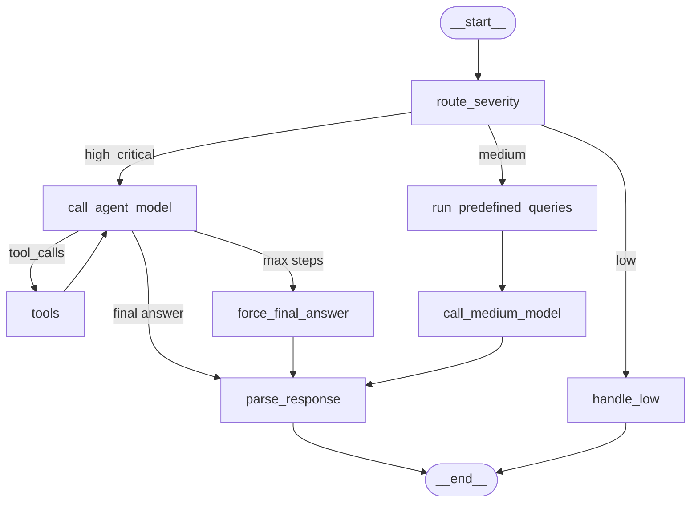

# DQ Agent LangGraph — Cheat Sheet

## Architecture Overview

```
state.py          → What the agent knows (shared state schema)
tools.py          → What the agent can do (SQL, schema, history)
prompts.py        → What the agent is told (system instructions)
graph.py          → How the agent thinks (nodes + edges + routing)
graph_builder.py  → How you create it (factory + model config)
evals.py          → How you test it (mock tools + keyword scoring)
teams_alerting.py → How it reports (Teams webhook, Adaptive Cards)
```

The agent runs as a **batch job** (`src/jobs/dq_agent_langgraph.py`) — after the
ETL flow (scheduled) or on demand (parameterized job run). MLflow tracing gives
production observability; there is no app or UI layer.

## Graph Diagram (Mermaid)



> **Render at runtime in Databricks:**
> ```python
> from IPython.display import Image, display
> display(Image(dq_agent.get_graph().draw_mermaid_png()))
> ```

---

## File-by-File

### `state.py` — State Schema

**What:** Defines `AgentState(TypedDict)` — the single shared object that all nodes read/write.

**Key concept:** `messages: Annotated[list, add_messages]` — the reducer that auto-appends messages instead of overwriting.

| Field | Purpose |
|-------|---------|
| `findings` | Input: DQ check results (set at invoke time) |
| `run_date`, `catalog`, `env_prefix` | Input: runtime context |
| `severity_tier` | Routing: which path to take |
| `messages` | LLM conversation (accumulated via reducer) |
| `summary`, `root_causes`, `recommendations`, etc. | Output: parsed analysis |

**LangGraph resources:**
- [State Management](https://langchain-ai-langgraph-40.mintlify.app/concepts/state)
- [add_messages reference](https://reference.langchain.com/python/langgraph/graph/message/add_messages)

---

### `tools.py` — Agent Tools

**What:** Three `@tool`-decorated functions the LLM can call during investigation.

| Tool | Purpose |
|------|---------|
| `run_sql` | Execute read-only SQL against Unity Catalog |
| `get_table_schema` | Get column names/types for a table |
| `query_dq_history` | Check DataQualityResults for recurring patterns |

**Key pattern:** Module-level globals (`_spark`, `_catalog`, `_run_date`) injected via `configure_tools()` at graph creation time — tools only expose LLM-facing args.

**LangGraph resources:**
- [LangChain @tool decorator](http://python.langchain.com/docs/concepts/tools/)
- [ToolNode (executes these automatically)](https://reference.langchain.com/python/langgraph.prebuilt/tool_node/ToolNode)

---

### `prompts.py` — System Prompts

**What:** Three prompt constants — no framework code, just text.

| Constant | Used when |
|----------|-----------|
| `AGENTIC_SYSTEM_PROMPT` | HIGH/CRITICAL → full tool-use investigation |
| `MEDIUM_SYSTEM_PROMPT` | MEDIUM → interpret pre-computed results |
| `FORCED_FINAL_PROMPT` | Max tool steps exhausted → produce answer now |

**No LangGraph resources** — prompts are framework-agnostic.

---

### `graph.py` — Graph Definition (the core)

**What:** Defines the `StateGraph` — nodes (functions) connected by edges (transitions).

**Nodes:**

| Node | What it does |
|------|-------------|
| `route_by_severity` | Classifies findings, builds initial messages |
| `call_agent_model` | Calls LLM with tools bound |
| `tools` (ToolNode) | Executes tool calls from the LLM |
| `force_final_answer` | Forces JSON output when max steps hit |
| `parse_response` | Extracts structured fields from LLM JSON |
| `handle_low` | Skips LLM entirely for LOW/passing |
| `run_predefined_queries` | Runs hardcoded SQL for MEDIUM path |
| `call_medium_model` | Single LLM pass (no tools) |

**Edges:**

```
route_severity ──conditional──► call_agent_model (HIGH/CRITICAL)
                              ► run_predefined_queries (MEDIUM)
                              ► handle_low (LOW)

call_agent_model ──conditional──► tools (has tool_calls)
                               ► parse_response (final answer)
                               ► force_final_answer (max steps)

tools ──────────────────────────► call_agent_model  ← THE CYCLE

force_final_answer ─────────────► parse_response
run_predefined_queries ─────────► call_medium_model ► parse_response
parse_response / handle_low ────► END
```

**LangGraph resources:**
- [Nodes, Edges & Control Flow](https://langchain-ai-langgraph-40.mintlify.app/concepts/nodes-edges)
- [StateGraph reference](https://reference.langchain.com/python/langgraph/graph/state/StateGraph)
- [ToolNode reference](https://langchain-ai-langgraph-40.mintlify.app/api/prebuilt/tool-node)
- [Conditional edges](https://langchain-ai-langgraph-40.mintlify.app/concepts/nodes-edges) — "Conditional Edges" section
- [Cycles and loops](https://langchain-ai-langgraph-40.mintlify.app/concepts/nodes-edges) — "Cycles and Loops" section

---

### `graph_builder.py` — Factory

**What:** `create_dq_agent()` → wires LLM + tools + graph, returns compiled runnable.

**Steps:**
1. Create `ChatDatabricks(endpoint=...)` — the LLM client
2. `configure_tools(spark, catalog, run_date)` — inject SparkSession
3. `build_graph()` → `graph.compile()` → return `CompiledStateGraph`

**Usage:**
```python
agent = create_dq_agent(spark, catalog="`p-cdh`", run_date="2026-07-12")
result = agent.invoke({"findings": [...], "run_date": "...", "catalog": "...", "env_prefix": "..."})
```

**LangGraph resources:**
- [ChatDatabricks](https://docs.langchain.com/oss/python/integrations/chat/databricks)
- [StateGraph.compile()](https://reference.langchain.com/python/langgraph/graph/state/StateGraph)

---

### `evals.py` — Evaluation Framework

**What:** Runs the real graph with mocked tools, scores output against expected keywords.

**Key approach:** `unittest.mock.patch` on `tool.invoke()` — the graph executes exactly as in production, only Spark is faked.

**Usage:**
```python
from dq_agent_langgraph.evals import run_eval_suite, compare_models
results = run_eval_suite(spark, model="databricks-meta-llama-3-3-70b-instruct")
compare_models(spark, models=["databricks-meta-llama-3-3-70b-instruct", "databricks-claude-sonnet-4"])
```

**Pass criteria:** Score ≥ 50% (keyword presence in output).

**LangGraph resources:**
- [Testing LangGraph](https://docs.langchain.com/oss/python/langgraph/test)
- [Evaluate a graph (LangSmith)](https://docs.smith.langchain.com/evaluation/how_to_guides/langgraph)

---

### `teams_alerting.py` — MS Teams Alerting

**What:** Formats failures + agent output into Adaptive Cards, posts to Teams webhook.

**Interface:** Reads from `agent_state: dict` (the graph's final state) — picks out `summary`, `root_causes`, `recommendations`, `landed_table_origin`, `issue_owner`.

**No LangGraph resources** — pure HTTP + JSON formatting.

---

## Deployment: Batch Job + Observability

The agent is deployed as a **Databricks batch job** wrapping the orchestrator
notebook `src/jobs/dq_agent_langgraph.py`. There is no app or UI.

**Parameters (job widgets):**

| Widget | Purpose | Example |
|--------|---------|---------|
| `run_date` | BusinessDate to validate | `2026-09-03` |
| `env_prefix` | Environment (auto-resolved from SSM if empty) | `p`, `qa`, `d` |
| `model_endpoint` | Databricks FMAPI model | `databricks-meta-llama-3-3-70b-instruct` |

**Two ways to run — same job, same code:**

1. **Scheduled (post-ETL):** Airflow triggers the job after the curated ETL
   completes. `run_date` is the ETL BusinessDate.
2. **On-demand (ad-hoc investigation):** Trigger the same job with different
   parameters — via the Databricks UI ("Run now with different parameters"),
   the CLI, or the Jobs API:
   ```bash
   databricks jobs run-now --job-id <ID> \
     --notebook-params '{"run_date": "2026-09-03", "env_prefix": "p"}'
   ```

**Observability (MLflow tracing):**

`mlflow.langchain.autolog()` captures the full LangGraph execution — severity
routing, every LLM call, each ReAct tool call, token usage, and latency — as a
nested trace. Each run is logged to the experiment `/Shared/dq_agent/{env}` and
tagged with `run_date`, `env_prefix`, `model_endpoint`, failure counts, and the
resolved `severity_tier`. Browse traces in the MLflow experiment UI.

**MLflow resources:**
- [MLflow Tracing](https://mlflow.org/docs/latest/llms/tracing/index.html)
- [LangChain / LangGraph autologging](https://mlflow.org/docs/latest/llms/langchain/autologging.html)

---

## Quick Reference: Dependencies

```
langgraph>=1.0.0              # StateGraph, ToolNode, add_messages
langchain-core>=1.0.0         # @tool, BaseMessage types, ChatModel interface
databricks-langchain>=0.4.0   # ChatDatabricks (FMAPI client)
mlflow>=2.18.0                # tracing / autolog (observability)
pyspark>=3.5.0                # SparkSession (tools execute SQL; provided by cluster)
```

## Quick Reference: Invocation

```python
# Notebook (batch, after DQ checks):
agent = create_dq_agent(spark, catalog, run_date, env_prefix, model_endpoint)
result = agent.invoke({"findings": [...], "run_date": "...", "catalog": "...", "env_prefix": "..."})

# Access outputs:
result["summary"]              # str
result["root_causes"]          # list[str]
result["recommendations"]      # list[str]
result["landed_table_origin"]  # str
result["issue_owner"]          # "source_system" or "etl_logic"
result["severity_overrides"]   # dict
```
